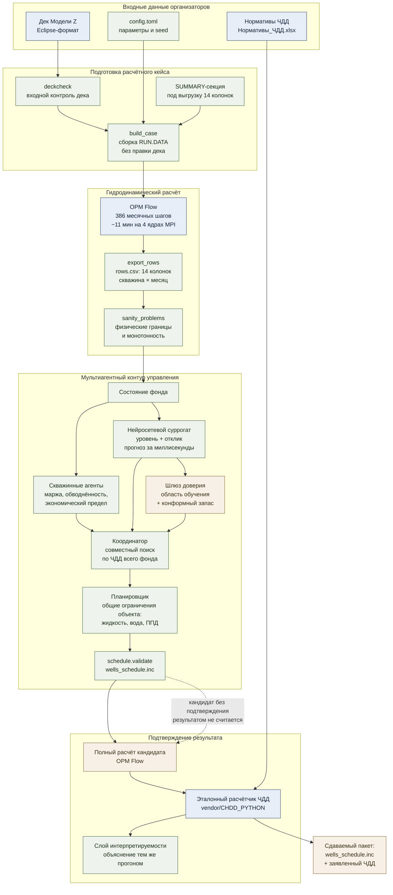
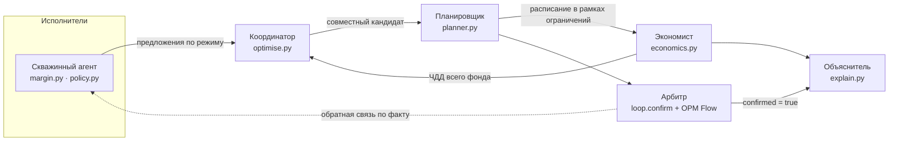

# AIOS · Трек 2 · Модель Z

**Мультиагентная система управления фондом скважин с нейросетевыми суррогатными
моделями.** Хакатон AIOS, ПАО «Татнефть» / Blue Sky Research.

Целевая функция — максимум чистого дисконтированного дохода (ЧДД) при соблюдении
технологических ограничений. Объект — гидродинамическая модель месторождения
(Модель Z): сетка 91×102×59, 103 управляемые скважины, история с 1991 года,
месячный шаг управления.

Результат работы системы — файл управляющих последовательностей
`wells_schedule.inc` и заявленное значение ЧДД, которое организаторы независимо
перепроверяют одним расчётом на полной гидродинамической модели.

---

## 1. Заявляемый результат

| Показатель | Значение |
|---|---|
| **Заявляемый ЧДД** | **5 579,5 млн руб.** (база дисконтирования 1991) |
| Базовый (исторический) сценарий | 5 300,5 млн руб. |
| **Прирост** | **+279,0 млн руб. (+5,26 %)** |
| База дисконтирования | **1991** — ответ трекера от 02.09.2026 (Р-158) |
| Начало управления фондом | 01.01.2007 — дата передачи фонда участнику по методике |
| Ставка дисконтирования (WACC) | 10 % |
| Расписание | `runs/matched-0995/wells_schedule.inc` |
| Чем посчитано | эталонный расчётчик организаторов `vendor/CHDD_PYTHON/` |
| Прогон | 24.08.2026, OPM Flow, 4 процесса MPI |

Число получено тем же прогоном, что и сдаваемый файл, и воспроизводится шестью
командами — они перечислены в `docs/submission.md`.

### Сверка базового сценария с расчётом организаторов

30.08.2026 организаторы опубликовали собственный расчёт базового сценария в двух
симуляторах. Сверка выполнена в единой системе отсчёта (база 1991 года, как в их
публикации):

| Расчёт | ЧДД, млн руб. | Отклонение нашего прогона |
|---|---:|---:|
| Эталон организаторов, тНавигатор | 5 218,9 | **−0,21 %** |
| **Наш прогон, OPM Flow** | **5 207,7** | — |
| Эталон организаторов, OPM Flow | 5 157,0 | **+0,98 %** (при `chargeInitialPump = ДА`, как считали они; без флага +2,78 %) |
| Разрыв между двумя эталонами организаторов | 61,9 | 1,20 % |

Совпадение по накопленной добыче нефти с эталоном в том же симуляторе —
**0,01 %** (5 011,16 против 5 011,55 тыс. т), по закачке — **0,00 %**. Счётчики
событий методики (смены ЭЦН, переводы под закачку) сходятся точно.

Команда сверки:

```bash
python scripts/compare_reference.py --charge-initial-pump --explain
```

---

## 2. Пайплайн

Сквозной контур «управляющие последовательности → симулятор → расчёт ЧДД»
собран в одну команду `scripts/run_all.py`.



Четыре шага контура и их назначение:

| Шаг | Модуль | Что делает |
|---|---|---|
| 1. Расписание | `aios/schedule.py` | управление фондом по датам; валидация до записи файла |
| 2. Симулятор | OPM Flow, `scripts/run_flow.sh` | 386 месячных шагов на полной ГГДМ |
| 3. Выгрузка | `aios/summary.py`, `scripts/export_rows.py` | ровно 14 колонок расчётчика; в базовом прогоне 38 110 строк |
| 4. Экономика | `aios/economics.py` + `vendor/CHDD_PYTHON/` | ЧДД по методике организаторов, без собственной формулы |

---

## 3. Архитектура мультиагентной системы

Архитектура выбрана осознанно: схема «агент на скважину» без координации не
масштабируется — нестационарность среды, неразрешимое распределение заслуги и
эффект «ленивого агента». Кроме того, скважины связаны через общий пласт: на
Модели Z совместное применение форсажа отбора и роста закачки дало на
**369,6 млн руб. больше**, чем сумма их раздельных эффектов. Поэтому принята
иерархия «планировщик → исполнители» с общим сигналом ЧДД всего фонда.



| Роль | Что видит и предлагает | Реализация |
|---|---|---|
| Скважинный агент | маржа, обводнённость, устойчивость убытка → остановка или множитель режима | `aios/margin.py`, `aios/policy.py` |
| Координатор | совместный кандидат, дефицит общих ресурсов | `aios/optimise.py` |
| Планировщик | ограничения объекта: жидкость, источник воды, компенсация, мощность ППД | `aios/planner.py` |
| Экономист | ЧДД всего фонда единой методикой | `aios/economics.py` + вендор |
| Арбитр | подтверждение кандидата полным расчётом ГГДМ | `aios/loop.py` + OPM Flow |
| Объяснитель | человеко-читаемое обоснование каждого решения | `aios/explain.py` |

Порядок операций цикла `aios.loop.run_cycle` фиксирован: прогноз базы → совместный
координатный поиск по ЧДД фонда → причинная политика остановок (только данные до
даты решения) → приведение к общим ограничениям → валидация расписания → полный
расчёт. До полного расчёта поле `CycleResult.confirmed` равно `False`, и результат
результатом не считается.

Объяснение решения генерируется **тем же прогоном**, что и само решение: языковая
модель получает уже посчитанные факты, все числа ответа проверяются, ответ с новым
числом отвергается целиком.

---

## 4. Суррогатная модель

Полный расчёт занимает 13–16 минут, оптимизатору нужны тысячи оценок. Суррогат —
быстрая модель-заместитель, обучаемая на выборке уже посчитанных прогонов.

**Архитектура.** По одному `MLPRegressor` (скрытые слои 32 и 16) на скважину.
Вход — общий вектор: нормированный месяц, сезонные `sin/cos` и управляющие
множители **всех** скважин фонда, раздельно по добыче и закачке. Выход — пять
величин на месяц: `WLPT_Diff`, `WOMT_Diff`, `WWIT_Diff`, `THP`, `BHP`.

Прогноз разложен на **уровень** (среднее обучающих сценариев для пары
«скважина × месяц») и **отклик** на управление — именно по отклику работает
оптимизатор. ЧДД суррогат не предсказывает: он считается расчётчиком организаторов
из предсказанных величин.

| Параметр обучения | Значение |
|---|---|
| Данные | 5 пакетов DoE (латинский гиперкуб), 60 сценариев |
| Разбиение | 45 train / 15 test, **по целым сценариям** |
| Строк | 2 286 600; метрики на 346 080 строках с 01.01.2007 |
| Скважин | 103, без исключений |
| Seed | 20260817 из `config.toml` |
| Артефакт | `artifacts/surrogate.joblib` + `artifacts/surrogate-metrics.json` |

Метрики по нефти (`WOMT_Diff`) на тестовых сценариях:

| Метрика | Нейросеть | Линейный бейзлайн |
|---|---:|---:|
| `R²` полной цели | **0,9547** | 0,9410 |
| `R²` уровня | 0,9079 | — |
| `R²` отклика | **0,5081** | 0,3599 |
| MAE, т/мес | 21,95 | 23,77 |
| RMSE, т/мес | 45,77 | 52,20 |

По жидкости `R²` = 0,9707 (отклик 0,6910), по закачке `R²` = 0,9871
(отклик 0,8532).

**Шлюз доверия** (`artifacts/trust-gate.json`) работает на уровне целого сценария:
евклидово расстояние до 5-го соседа в стандартизованном пространстве, порог
21,62, конформный запас на оптимизм 927,8 млн руб. Кандидат вне области доверия
уходит на полный расчёт, а не принимается по прогнозу. Подробно — `docs/surrogate.md`.

---

## 5. Комплект поставки

| Позиция | Где |
|---|---|
| Код пайплайна | `aios/` — 30 модулей |
| Обучение суррогата | `scripts/train_surrogate.py` |
| Журнал экспериментов | `docs/experiments.md` |
| Docker-образ с симулятором | `docker/Dockerfile` |
| Конфигурация и seed | `config.toml` + четыре сценарных конфига |
| Инструкция запуска | разделы 6–7 настоящего документа |
| Тесты | `tests/` и тесты вендора — 1101 тест, прогон 31.08.2026 |
| Веб-платформа | `aios/web/`, FastAPI, inline-SVG, без внешних ресурсов |

Проверка комплектности одной командой — она разбирает расписание, проверяет
ограничения, сверяет md5 с заявкой и прогоняет модель через порог качества:

```bash
python scripts/check_package.py \
  --schedule runs/matched-0995/wells_schedule.inc \
  --model artifacts/surrogate.joblib
```

В день отправки действует стоп-лист `docs/submission-day.md`: пакет не уходит,
пока **все шесть проверок** не дали указанный там результат.

---

## 6. Установка

Требуется Python 3.11 или новее, Git и около 300 МБ на диске. Для
гидродинамического расчёта дополнительно нужен OPM Flow или Docker.

```bash
python3 -m venv .venv           # Linux и macOS
. .venv/bin/activate
pip install -r requirements-dev.txt
```

```powershell
py -3 -m venv .venv             # Windows
.venv\Scripts\activate
pip install -r requirements-dev.txt
```

`requirements.txt` — рантайм решения, попадающий в Docker-образ;
`requirements-dev.txt` — дополнительно тесты и линтер: это всё, что нужно, чтобы
проверить решение. `requirements-tools.txt` — инструменты разбора материалов
организаторов (расшифровка записей встреч, чтение pdf-лекций); проверке они не
нужны и ставятся долго, поэтому вынесены отдельно. `requirements.lock` снят на
Linux и предназначен для воспроизведения среды образа, а не рабочего места.

Распаковка дека из материалов организаторов:

```bash
unzip -q materials/Model_Z_final_OPM.zip -d vendor -x "__MACOSX/*"
mv vendor/Model_Z vendor/Model_Z_OPM
```

```powershell
Expand-Archive materials\Model_Z_final_OPM.zip -DestinationPath vendor
Rename-Item vendor\Model_Z Model_Z_OPM
```

---

## 7. Запуск

### Сквозной прогон одной командой

```bash
python scripts/run_all.py --flow-args=--parsing-strictness=low
```

Пять шагов без ручного вмешательства: собрать кейс → посчитать базовый сценарий на
ГГДМ → пройти цикл управления и собрать расписание → посчитать получившийся
сценарий → заменить прогноз полным расчётом. Флаг `--dry-run` печатает план шагов
на машине без симулятора.

**Эта команда показывает, что контур проходит целиком, — она не воспроизводит
заявку.** Цикл на тривиальном бейзлайне даёт расписание хуже исторического
(замеры 03.09 в `docs/experiments.md`), и прогон честно завершится **ненулевым
кодом**, если прирост не положителен или нарушены условия кейса. Заявляемое число
— отдельный, выбранный и проверенный сценарий; воспроизводится оно так:

```bash
python scripts/verify_declared.py --run runs/matched-0995
```

Команда пересчитывает заявленный ЧДД **точкой входа организаторов** из выгрузки
сдаваемого прогона и сверяет с `docs/submission.md`.

### Расчёт в Docker

```bash
docker build --platform linux/amd64 -t aios -f docker/Dockerfile .
python scripts/build_case.py
docker run --rm -v "$PWD:$PWD" -w "$PWD" aios \
    scripts/run_flow.sh runs/base/RUN.DATA 4 --parsing-strictness=low
python scripts/export_rows.py runs/base
```

Тот же сквозной прогон целиком в контейнере, одной командой:

```bash
docker run --rm -v "$PWD:$PWD" -w "$PWD" aios \
    python scripts/run_all.py --flow-args=--parsing-strictness=low
```

**`--platform linux/amd64` при сборке обязателен на Apple Silicon и других
arm64-машинах.** Образ ставит зависимости с `--require-hashes`, а
`requirements.lock` содержит хэши колёс только под linux-x86_64 — на arm64 pip
скажет `THESE PACKAGES DO NOT MATCH THE HASHES` и сборка упадёт. Это не дефект
lock-файла: хэши и есть та проверка, ради которой он существует, а собирать под
две архитектуры мы не проверяли ни разу.

Два обязательных условия прогона:

- **том монтируется по тому же пути, что и на хосте** (`-v "$PWD:$PWD"`) — собранный
  `RUN.DATA` ссылается на файлы дека абсолютными путями;
- **флаг `--parsing-strictness=low` обязателен** — дек содержит ключевое слово
  `PINCHREG`, не поддерживаемое OPM Flow. Флаг не зашит в скрипт намеренно: он
  влияет на физику расчёта и должен быть виден в команде.

Дек организаторов в образ не помещается — он монтируется томом. Полный расчёт
истории занимает около 11 минут на 8-ядерной машине (4 процесса MPI).

### Веб-платформа

```bash
python -m uvicorn aios.web.app:app --reload
```

http://127.0.0.1:8000 — прогоны, экономика, экономический предел скважин, запуск
цикла управления с объяснением каждого решения. Страницы не обращаются ни к одному
внешнему ресурсу.

### Контроль качества

```bash
python -m ruff check .
python -m pytest -q
```

`pytest` выполняет и наши тесты, и тесты эталонного расчётчика организаторов.

**Мутационный прогон — отдельная проверка, и она отвечает на другой вопрос.**
Зелёная сюита говорит, что код проходит тесты; мутационный прогон — поймали бы
тесты **изменение поведения**:

```bash
python scripts/mutate.py --module aios/balance.py --limit 25     --tests tests/test_balance.py --tests tests/test_planner.py
```

Подменяется только смысл — сравнения, границы, булевы связки и константы; отбор
мутаций через `--seed`, поэтому число «выжило N» воспроизводится. Код возврата
`2`, если хоть одна подмена пережила тесты; `--only N` повторяет ровно ту, что
названа в отчёте.

Замер 05.09 по шести модулям: проверено 137 подмен, **убито 128**. По
`balance`, `economics`, `trust`, `schedule` выживших нет; по `planner` — 26 из
30, по `policy` — 20 из 25. Все девять оставшихся разобраны в
`docs/decisions.md` (Р-221 … Р-229) поимённо и признаны эквивалентными — каждая
с доказательством, а не с оценкой.

**На чистом клоне 18 тестов пропускаются, и это ожидаемо.** Проверено запуском
04.09: 1 452 теста, 0 падений, 18 пропусков. Пропуск здесь — не «проверка не
работает», а «проверять нечего на этой машине», и каждый называет причину прямо
в выводе (`pytest -q -rs` покажет список):

| Сколько | Чего не хватает | Как получить |
|---:|---|---|
| 9 | выгрузок `runs/base` и `runs/matched-0995` | шесть команд `docs/submission.md`, раздел 3 — нужен симулятор |
| 5 | чужих открытых деков для проверки переносимости | клонируются командой из `docs/portability.md` |
| 2 | Node.js и `core.js` организаторов для межъязыковой сверки | `core.js` в поставку не входил (`BLOCKED.md`, п. 0.6) |
| 1 | кэша демо-объяснений | один прогон с ключом модели (`BLOCKED.md`, п. 0.2-бис) |
| 1 | следа расчёта заявки рядом с выгрузкой | тот же прогон, что и в первой строке |

Ни один из пропусков не скрывает падения: те же тесты на машине с выгрузками
проходят, и там пропусков остаётся 6.

---

## 8. Структура репозитория

```
aios/
  economics.py   ЧДД: тонкая обвязка над эталонным расчётчиком организаторов
  deck.py        разбор SCHEDULE-секции дека (DATES / WCONPROD / WCONINJE)
  schedule.py    генерация и валидация wells_schedule.inc
  summary.py     SUMMARY-секция и выгрузка результата в 14 колонок расчётчика
  run.py         сборка расчётного кейса поверх дека без его правки
  margin.py      экономический предел скважины
  policy.py      политика: от диагноза к управляющим действиям с объяснением
  surrogate.py   интерфейс суррогата и тривиальный бейзлайн
  neural.py      нейросетевой суррогат: уровень + отклик, метрики, происхождение
  optimise.py    совместный координатный поиск по ЧДД фонда
  planner.py     согласование решений через общие ограничения объекта
  trust.py       область доверия и конформный запас оптимизма
  loop.py        цикл МАС: состояние → диагноз → решения → прогноз → ЧДД
  explain.py     слой интерпретируемости
  doe.py         планирование эксперимента для обучения суррогата
  shapley.py     причинный вклад групп скважин через коалиционную игру
  config.py      чтение config.toml
  web/           веб-платформа: FastAPI, inline-SVG графики
config.toml      все параметры, влияющие на число ЧДД, и seed
docker/          образ с OPM Flow и рантаймом
scripts/
  build_case.py  собрать кейс:  python scripts/build_case.py
  run_flow.sh    запустить OPM Flow (Linux)
  export_rows.py проверить прогон и собрать rows.csv для команды
  build_doe.py   сгенерировать сценарии DoE и собрать под них кейсы
  run_doe.py     возобновляемо посчитать пакет DoE и записать статус
  pack_npv.py    ЧДД эталонным расчётчиком по каждому сценарию пакета
  train_surrogate.py обучить MLP на целых сценариях и записать held-out метрики
  freeze_holdout.py заморозить внешний тест — сценарии, по которым ничего не выбирают
  trust_gate.py  собрать область либо проверить кандидата с конформным запасом
  check_deck.py  входной контроль чужого дека перед генерацией SCHEDULE
  forcing_check.py достижим ли форсаж отбора по помесячной истории
  shapley_plan.py план коалиций: точный вклад групп в ЧДД
  run_shapley.sh посчитать все ячейки плана подряд (Linux)
  make_lock.py   собрать requirements.lock с хэшами из отчёта resolver'а
  transcribe.py  расшифровка записей встреч организаторов
docs/
  onboarding-team.md подключение нового участника
  task.md            постановка задачи и критерии
  architecture.md    архитектура МАС
  surrogate.md       архитектура, обучение и проверка качества суррогата
  setup-simulator.md установка симулятора и первый прогон
  method/            методики ЧДД, выжимки лекций, разбор отличий
  decisions.md       инженерные решения
  experiments.md     журнал прогонов
  portability.md     переносимость: что входной контроль отвергает и почему
  scalability.md     масштабируемость: три уровня переноса и цена каждого
  explainability.md  чем меряется качество объяснений
  llm-rationale.md   зачем в решении языковая модель и чего ей не доверено
materials/       всё, что выдали организаторы: деки, расчётчик, лекции, методики
tests/           наши тесты, включая пограничные случаи методики
JOURNAL.md       рабочий журнал: что делали и что из этого вышло
HANDOFF.md       передача смены между машинами и сессиями
BLOCKED.md       что упёрлось в человека и ждёт ответа снаружи
manus-answered/  задания агенту-исполнителю и его ответы
vendor/
  CHDD_PYTHON/   эталонный расчётчик ЧДД организаторов — вендорен побайтово
  Model_Z_OPM/   дек Модели Z (в репозиторий не коммитится)
```

Четыре последних пункта — рабочие журналы, а не решение: держим их в репозитории
осознанно (Р-131), чтобы ход работы читался проверяющим. Служебные архивы обмена
между нашими машинами (`data.7z`, `to-machine-b.7z`) в git **не** лежат —
воспроизводятся `scripts/build_dataset.py` и передаются мимо репозитория.

---

## 9. Документация

| Документ | Содержание |
|---|---|
| `docs/kt2-explained.md` | материал к контрольной точке 2: требования, сверка, метрики |
| `docs/kt2-plan.md` | план выступления: раскладка по минутам, вопросы и ответы |
| `docs/architecture.md` | архитектура МАС, роли агентов, контракты между слоями |
| `docs/surrogate.md` | суррогат: данные, архитектура, обучение, метрики |
| `docs/submission.md` | заявляемое число: чем получено и как воспроизводится |
| `docs/submission-day.md` | стоп-лист дня отправки: проверки, без которых пакет не уходит |
| `docs/method/diff.md` | две редакции методики ЧДД: что изменилось и чем считаем |
| `docs/decisions.md` | инженерные решения с обоснованием |
| `docs/experiments.md` | журнал всех прогонов |
| `docs/explainability.md` | чем измеряется качество объяснений |
| `docs/portability.md` | переносимость: что отвергает входной контроль и почему |
| `docs/task.md` | постановка задачи, критерии оценки, регламент сдачи |

---

## 10. Принцип расчёта ЧДД

ЧДД считается **исключительно** эталонным расчётчиком организаторов
(`vendor/CHDD_PYTHON/`, версия `7.0.2-negative-row-filter`), вендоренным побайтово.
Собственной формулы ЧДД в проекте нет: организаторы пересчитывают сдаваемый файл
своим кодом один раз, и расхождение заявленного значения с их результатом означает
дисквалификацию. Пограничные случаи методики — фильтрация отрицательных
приращений, логика смены ЭЦН, учёт остановок и пусков, перевод под закачку,
предел дебита жидкости, состав действующего фонда, налоги и дисконтирование —
закреплены тестами в `tests/`.

---

## 11. Лицензии и сторонние компоненты

Расчёт выполняется в **OPM Flow** — GPL-программе; вместе с ней распространяются
`opm-common`, `opm-grid` и прямая зависимость `resdata`. Передача Docker-образа с
ними является передачей объектного кода по GPLv3 §6, поэтому в пакет включены:

- `LICENSES/` — полные тексты лицензий из дистрибутивов;
- `THIRD_PARTY_NOTICES.md` — компоненты, версии, лицензии, источники исходного кода;
- `MODIFICATIONS.md` — правки стороннего GPL-кода с датами и файлами;
- `PROVENANCE_AND_RIGHTS.md` — реестр прав на материалы организаторов.

Собственный код проекта распространяется под **MIT**, © 2026 Ivan Banan. Под неё
попадают `aios/`, `scripts/`, `tests/`, `docker/`, корневые документы и
конфигурация, а также `docs/` кроме `docs/method/` и `docs/screenshots/`. Не
попадают и остаются на условиях правообладателей: `vendor/`, `materials/`,
`docs/method/`, `docs/screenshots/`, `manus-answered/`, `LICENSES/`, архивы данных
и сторонние библиотеки, включая OPM Flow. Пофайловый перечень — в `LICENSE`.
